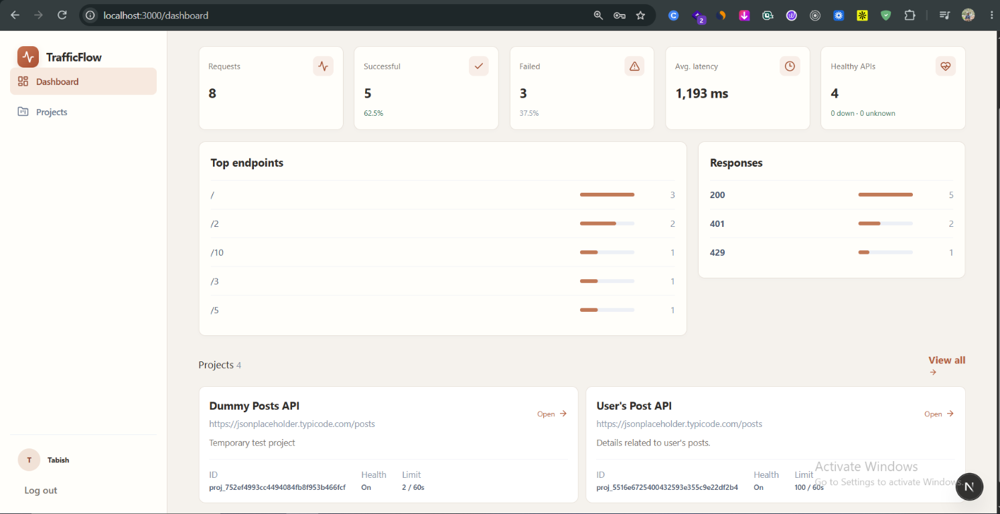
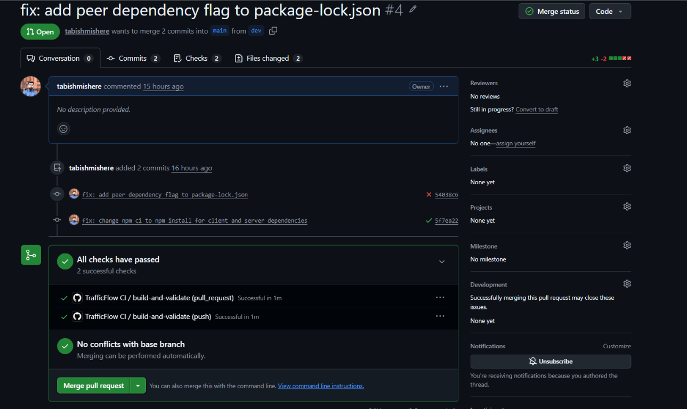

# TrafficFlow

**A configurable API gateway for protecting and monitoring the APIs you already run.**

[](https://github.com/tabishmishere/TrafficFlow/actions/workflows/ci.yml)

TrafficFlow gives each project a managed gateway URL, API key, and configurable rate limit. Requests are authenticated, forwarded to the configured upstream, and recorded for a dashboard with traffic history and optional health checks.

## Features

- **Project-based access:** user accounts, project ownership, and project-specific API keys.
- **Gateway and rate limiting:** forwards `GET`, `POST`, `PUT`, `PATCH`, and `DELETE` requests to configured HTTP(S) APIs; applies per-project, per-client-IP limits with Redis.
- **Traffic visibility:** request status, latency, path, and method, with dashboard aggregates and filtering.
- **Health monitoring:** optional scheduled checks for configured upstream endpoints.
- **Credential handling:** API keys are shown when created; only their hash and masked metadata are stored.
- **API tester:** send a GET request through a project gateway from the workspace.

## How it works

The Next.js workspace calls the Express API for project management and reporting. Gateway requests use a project key; the API validates the key, checks the Redis rate limit, forwards the request, and stores the outcome in PostgreSQL.

**Stack:** Next.js 16 · React 19 · TypeScript · Tailwind CSS 4 · Express 5 · Prisma 6 · PostgreSQL 17 · Redis 7 · Docker Compose

## Run locally

### Requirements

- Docker Desktop with Docker Compose

### Start the application

From the repository root, create the backend environment file:

```powershell
Copy-Item .\server\.env.example .\server\.env
```

Edit `server/.env` and set a local `POSTGRES_PASSWORD` and a long, unique `JWT_SECRET`. Then build and start the application:

```powershell
docker compose up --build
```

Open [http://localhost:3000](http://localhost:3000), create an account, and configure a project. The API is available at [http://localhost:4000](http://localhost:4000). Stop the services with `docker compose down`.

## CI

The [TrafficFlow CI workflow](https://github.com/tabishmishere/TrafficFlow/actions/workflows/ci.yml) runs on pushes and pull requests. It installs dependencies, lints and builds the client, generates the Prisma client, and builds the server.

The screenshot records both CI checks passing on pull request #4. The current workflow validates linting and builds; it does not yet run automated unit or integration tests.

## Screenshots

**Dashboard**



**CI checks passing on pull request #4**



## Project structure

```text
client/                 Next.js application
server/                 Express API, gateway, and Prisma schema
docs/screenshots/       Application and CI screenshots
docker-compose.yml      Application and supporting services
.github/workflows/      GitHub Actions CI
```
